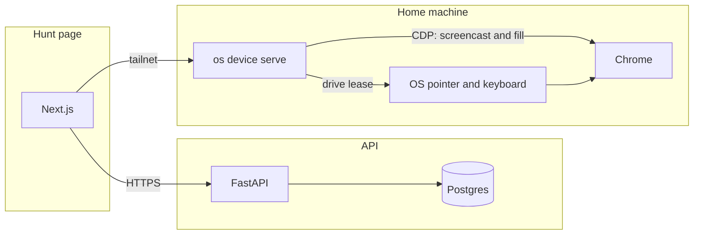

# Hunt

Hunt fills job applications from a career record and a library of facts, then learns each miss instead of guessing. A field is answered by a pattern that names one fact, a formatter that renders it, and a strategy that operates the control. When that fails, a model may propose a new pattern or one small piece of code, and the proposal is kept only if replay against answers already accepted says it is the same fact.

This repository is a public snapshot of that system: the worker, the device agent, the API, the career record and resume PDF, and the Hunt page. It is here to be read. It is not a hosted service, and the fixtures use placeholder people.

## Architecture

The page and the `os hunt` command talk to one FastAPI service. That service is the only database client. A home machine runs `os device serve` on loopback and publishes it on a tailnet. The page lists that device, starts `os hunt apply` there, and shows the device's Chrome. The fill can drive the page through Chrome's debugging port. The submit that has to look like a person does not: it leases one tab and types through the operating system.



| Path | What it is |
|---|---|
| `workers/` | `os` CLI, the apply and learning loop, and the device agent |
| `backend/` | FastAPI: auth, listings, facts, the career record, and the resume PDF |
| `frontend/` | Hunt page, resume editor, and narrative library |
| `database/` | Schema migrations for that API |
| `artifacts/career/` | Cover-letter template the apply run fills |
| `docs/` | How a field is filled, the CLI, and the remote-submit design |

## Learning loop

1. A question's label is matched by an active binding or a regex expression. Each one names exactly one fact. Nothing is discarded because a title is not a preferred role; discovery keeps the row and tags it.
2. A formatter turns that fact into the string or choice the control can hold. A strategy operates the control. Readback checks that the page shows the value.
3. A miss is classified. A missing pattern, a format the control will not take, a strategy that cannot drive the widget, and an unreadable question are different problems.
4. During the run, a model may be asked one bounded question: which fact answers this, or which one new file would teach the registry to handle this widget. The model does not write the value into the form.
5. Replay runs the proposal against answers already accepted. A pattern is saved, and a learned file is loaded, only when that check passes. The ordinary fill path then writes the fact through the formatter, the same way it writes every other field.

Long-form answers are composed from the narrative library. The library is the approved writing. A paragraph typed into an application is not copied back into it.

## Remote submit

Lever rejected a completed application whose press was a scripted CDP click: the form was cleared with "There was an error verifying your application." The same profile and IP accepted a person's press. Hunt's submit route is built around that difference.

`WS /drive` leases one tab on the device. Safety checks sit in the drive client: one listing, an allowlist of commands, a stop the device enforces, and no path onto other tabs. While the press runs, the tab is not held on a CDP session. Pointer motion and keystrokes come from the operating system, at about 110 words per minute, and the resume upload is part of that same press. The outcome is read from the page: Lever and Greenhouse confirmation URLs, Ashby's "application was successfully submitted," and a visible challenge frame.

Experiment 1, press and resume upload, submitted 2 out of 2 attempts. Five live submissions in all have gone through this route.

## Stack

Python 3.13, FastAPI, and Playwright; Next.js on the page; Postgres for the career record, facts, listings, and what the runs learn; Chrome on the device; a tailnet between the page and the agent.

## Run the tests

```bash
uv sync --all-packages --python 3.13
cd backend && uv run ruff check . && uv run mypy src/ && uv run pytest -q
cd ../workers && uv run ruff check . && uv run mypy src/ && uv run pytest -q
cd ../frontend && npm ci && npm run verify
```

`mypy` is limited to `src/` because the tests are not annotated. The shrimp-tracking paper that the page can serve at `/research/tiny-object-tracking` is a placeholder here. The original file named its authors, so it is not in this snapshot.

A real apply also needs the hosted database, a signed-in Chrome profile on the device, and `os device serve`. The tests do not.
